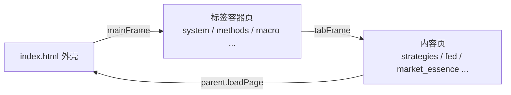

# 投资交易工作站 (p000_0000_money)

中文金融教育与交易管理 **纯前端静态原型**：零构建、零后端，浏览器打开即可使用。

## 快速开始

```bat
:: 方式一：直接双击 index.html
:: 方式二：本地静态服务（推荐，避免个别浏览器 file:// 限制）
start.bat
:: 即 npx http-server -p 3004 → http://localhost:3004
```

## 架构

- **外壳**：`index.html` — 顶栏 + 深色侧边栏 + 主内容 iframe + 状态栏
- **标签容器**：模块入口页（如 `trading/system.html`）用顶部 Tab + 内层 iframe 聚合子页
- **内容页**：独立可渲染的 HTML，数据全部硬编码
- **导航**：侧栏 `loadPage(path, title, evt)`；子页 `parent.loadPage(path)`（相对项目根）



## 模块一览

| 目录 | 职责 | 入口（侧栏可见） |
|------|------|------------------|
| `portal/` | 首页门户 | `portal/home.html` |
| `market/` | 行情市场、新闻、股市认知 | `market/market.html`, `read_news.html`, `cognition.html` |
| `trading/` | 交易体系、方法、个股、庄家散户 | `trading/system.html`, `methods.html`, `stock_analysis.html`, `manipulation.html` |
| `policy/` | 政策会议、宏观经济、市场规则 | `policy/meetings_policy.html`, `macro.html`, `rules.html` |
| `learning/` | 学习成长（系统/心得/评分/传记…） | `learning/notes.html` |
| `industry/` | 行业追踪与产业链 | `industry/overview.html` |
| `system/` | 系统设置 | `system/settings.html` |
| `trading/retail_mistakes/` | 散户误区子模块 | 由交易相关页跳转进入 |

页面数量：**51** 个 `.html`（含外壳与标签容器），均配有同名 `.md` 需求/结构说明。

## 技术栈（全 CDN）

| 库 | CDN | 用途 |
|----|-----|------|
| Tailwind CSS | `https://cdn.tailwindcss.com` | 布局与样式 |
| Font Awesome 6.4 | `https://cdnjs.cloudflare.com/.../font-awesome/6.4.0/...` | 图标 |
| Chart.js 3.9.1 | `https://cdnjs.cloudflare.com/ajax/libs/Chart.js/3.9.1/chart.min.js` | 仅图表页 |

无 `package.json`、无打包器、无 npm 依赖安装。

## 约定

- 界面语言 `zh-CN`，全文中文
- 涨红跌绿（A 股惯例）：`up: #DC2626` / `down: #10B981`
- 文件名小写 + 下划线
- 每个 `.html` 配同名 `.md`（概述 / 功能需求 / 页面结构 / 技术实现）
- 静态数据写死在 HTML 内，不调接口

## 文档索引

| 文档 | 说明 |
|------|------|
| `README.md` | 本文件：项目总览与导航 |
| `CLAUDE.md` | Agent 工作约定（架构、模式、增页流程） |
| 各模块 `*.md` | 与同名 `.html` 配对的页面说明 |
| `.claude/skills/html-prototype/SKILL.md` | 生成新页面的详细模板与模式 |

## 新增页面

1. 在对应模块目录创建 `.html`（沿用现有页 boilerplate）
2. 创建同名 `.md`（概述 / 功能 / 结构 / 实现）
3. 在 `index.html` 侧栏增加 `onclick="loadPage('module/x.html','标题',event)"`
4. 若为多子页入口，优先做成标签容器页，并更新侧栏 badge 子页数
